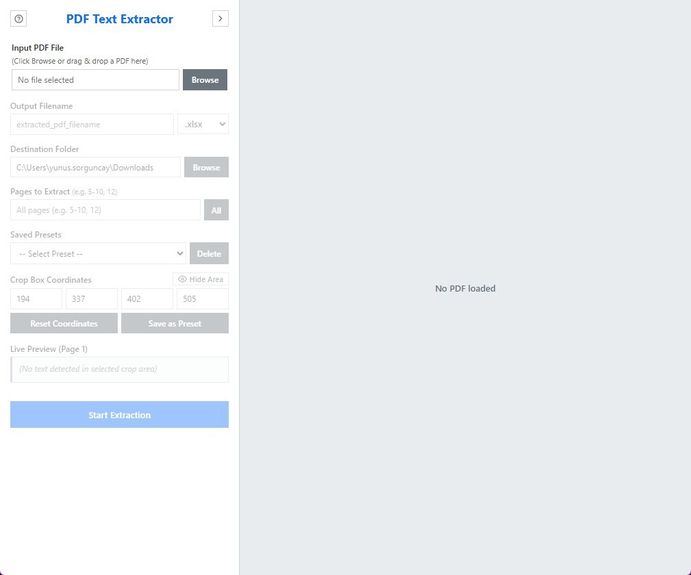
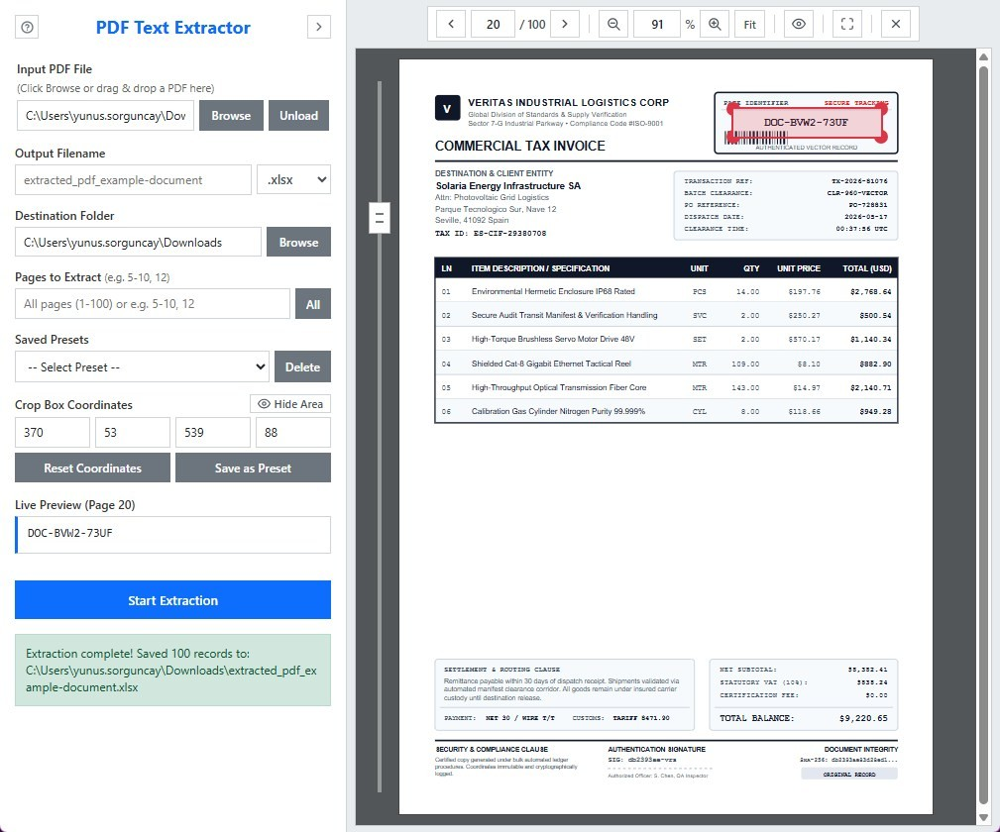
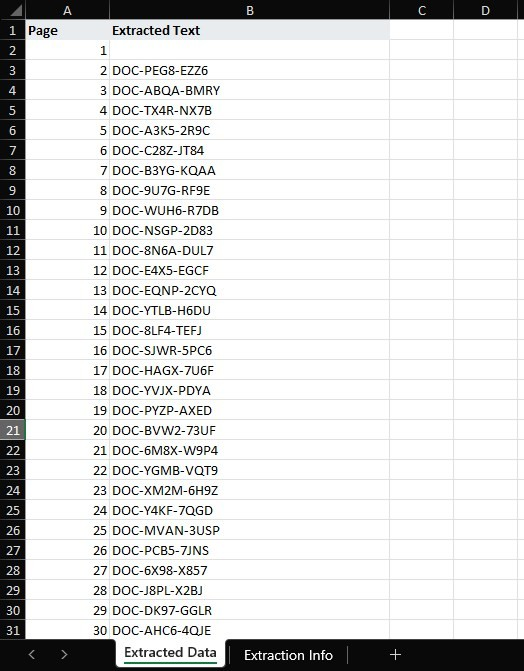

<p align="center">
  
  <br>
  <h1>PDF Text Extractor</h1>
  <strong>Cross-platform visual coordinate-bounded text extraction from PDF documents to Excel and CSV.</strong>
</p>

<p align="center">
  <a href="https://github.com/yunix0420/PDF-Text-Extractor/releases/latest"></a>
  
  
  
  <a href="LICENSE"></a>
</p>

---

## Overview

Extracting structured data elements (such as serial numbers, dates, reference codes, or form fields) from hundreds of uniform pages in PDF documents can be tedious or error-prone with general-purpose tools.

PDF Text Extractor solves this by providing an interactive visual canvas where you can select an exact rectangular coordinate area on any page and automatically extract the text contained in that bounding box across all or designated pages of the document into formatted Excel (.xlsx) workbooks or RFC 4180 compliant CSV files.

The application operates entirely offline and in-process. Documents are processed locally with zero network sockets, external APIs, or telemetry.

---

## Downloads

Download the latest precompiled release for your operating system:

| Platform | Direct Download |
| :--- | :--- |
| Windows (x64) | [Standalone Executable (.exe)](https://github.com/yunix0420/PDF-Text-Extractor/releases/latest/download/pdf-text-extractor-windows-amd64.exe) |
| Linux (x64) | [AppImage (.AppImage)](https://github.com/yunix0420/PDF-Text-Extractor/releases/latest/download/pdf-text-extractor-linux-amd64.AppImage) |
| macOS (Universal) | [Universal Disk Image (.dmg)](https://github.com/yunix0420/PDF-Text-Extractor/releases/latest/download/pdf-text-extractor-macos-universal.dmg) |

For complete release history, package checksums, and changelogs, visit the [Latest Release Page](https://github.com/yunix0420/PDF-Text-Extractor/releases/latest).

---

## Visual Interface

### Initial Interface
The clean startup state featuring intuitive file selection, destination picker, output format selection, and quick action controls:

<p align="center">
  
</p>

### Document Inspection and Coordinate Selection
Visual document preview with pixel-accurate interactive crop box, dynamic page centering, zoom controls, and live extracted text preview:

<p align="center">
  
</p>

### Extracted Excel Output
Structured spreadsheet generation containing extracted text columns, page numbers, and extraction metadata:

<p align="center">
  
</p>

---

## Sample Files and Quick Test

A pre-configured sample document and its corresponding extraction output are included in the repository so you can immediately test the application:

- **Sample Input PDF**: [examples/example-document.pdf](examples/example-document.pdf)
- **Sample Output Excel**: [examples/extracted_pdf_example-document.xlsx](examples/extracted_pdf_example-document.xlsx)

To perform a quick verification:
1. Open the application.
2. Click **Browse** and select `examples/example-document.pdf`.
3. Adjust the crop box over any target field on the page and verify the detected text in **Live Preview**.
4. Click **Start Extraction** to generate your output workbook.

---

## Features

- **Interactive Visual Cropping**: Drag, resize, and fine-tune your target selection box with pixel-accurate coordinates using Interact.js.
- **Live Text Preview**: Instantly inspect detected text within your crop box on the active page before initiating an extraction run.
- **Selective Page Range Processing**: Extract the entire document or specify arbitrary comma- and hyphen-delimited page ranges (e.g. `1-10, 15, 20-35`).
- **Dual Export Formats**:
  - **Excel (.xlsx)**: Generates a structured workbook with an "Extracted Data" sheet and an "Extraction Info" metadata sheet (date, file source, bounding box coordinates, and page counts).
  - **CSV (.csv)**: Generates atomic, RFC 4180 compliant CRLF, UTF-8 BOM encoded CSV files compatible with Microsoft Excel and text processors.
- **Coordinate Presets**: Save frequently used crop box dimensions with custom names for rapid reuse across similar document templates.
- **Native Desktop Controls**:
  - Drag-and-drop PDF file loading.
  - In-process PDF rendering via PDF.js canvas pipeline.
  - Panning and zooming (`Ctrl + Mouse Wheel` or toolbar controls).
  - Rapid page navigation via mouse wheel when fitted to page.
  - Toggleable selection overlay visibility (`Ctrl + H`).
  - Customizable UI layout (toggle sidebar menu between Left and Right).
  - Dedicated desktop context menu (Cut, Copy, Paste, Select All, Zoom, Presets).
  - Fullscreen toggle support.

---

## Prerequisites

Before building or running the project in development mode, ensure you have installed:

- [Go](https://go.dev/dl/) (version 1.22 or newer)
- [Node.js](https://nodejs.org/) (version 18 or newer) and npm
- [Wails CLI v2](https://wails.io/docs/gettingstarted/installation):
  ```bash
  go install github.com/wailsapp/wails/v2/cmd/wails@latest
  ```

### Platform-Specific Dependencies

- **Linux (Ubuntu 24.04+ / Debian)**:
  ```bash
  sudo apt update
  sudo apt install -y libgtk-3-dev libwebkit2gtk-4.1-dev pkg-config gcc
  ```
  *(For older distributions like Ubuntu 20.04/22.04, install `libwebkit2gtk-4.0-dev` instead)*
- **macOS**:
  - Xcode Command Line Tools (`xcode-select --install`).
- **Windows**:
  - Microsoft Edge WebView2 (preinstalled on Windows 10 and 11).
  - Optional: [NSIS](https://nsis.sourceforge.io/) for generating Windows installer packages.

---

## Getting Started

### 1. Clone the Repository
```bash
git clone https://github.com/yunix0420/PDF-Text-Extractor.git
cd PDF-Text-Extractor
```

### 2. Install Frontend Dependencies
```bash
cd frontend
npm ci
cd ..
```

### 3. Run Automated Tests
```bash
# Run backend Go unit tests
go test -v ./...

# Run frontend unit tests
npm --prefix frontend test
```

### 4. Run in Development Mode
```bash
wails dev
```
This starts the Go backend and launches Vite with hot module replacement. Any changes made to frontend or backend code will automatically trigger reloading.

### 5. Build for Production
To compile a native executable:
```bash
wails build
```
The compiled executable will be placed in `build/bin/`.

On Windows, to build an NSIS installer package:
```bash
wails build -nsis
```

---

## Usage Guide

1. **Load a Document**: Click **Browse** or drag and drop any PDF document into the application canvas.
2. **Adjust Coordinates**:
   - Use your mouse to drag or resize the selection box on the PDF canvas.
   - Alternatively, type exact coordinates (`Left`, `Top`, `Right`, `Bottom`) in the sidebar inputs.
3. **Verify with Live Preview**: Verify that the text detected in the preview box matches your expected target field.
4. **Choose Destination and Format**: Select an output destination directory and desired export format (`.xlsx` or `.csv`).
5. **Set Page Range**: Leave blank for all pages, or enter specific ranges like `1-10, 15, 20-35`.
6. **Extract**: Click **Start Extraction**. A progress bar will track extraction across pages and save the result atomically when complete.

---

## License

This project is licensed under the MIT License - see the [LICENSE](LICENSE) file for details.
